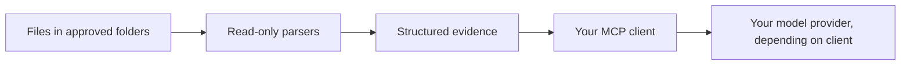

<p align="center">
  <picture>
    <source media="(prefers-color-scheme: dark)" srcset=".github/assets/chibitek-dark.svg">
    
  </picture>
</p>

<h1 align="center">ReversePlumbing</h1>
<p align="center">Understand installed software and saved browser traffic before designing something of your own.</p>
<p align="center">
  <a href="LICENSE"></a>
  <a href="#quickstart"></a>
  <a href="#faq"></a>
  <a href="#privacy-and-limits"></a>
</p>
<p align="center"><a href="#quickstart">Quickstart</a> · <a href="#what-you-can-do">Features</a> · <a href="#how-it-works">How it works</a> · <a href="docs/technical-reference.md">Reference</a></p>

ReversePlumbing is a local MCP server: it gives an AI client structured information about files you
allow it to read. Written from scratch by Chibitek, it helps turn evidence into an original product
specification. It does not reproduce the inspected product or prove how its server works.

## Quickstart

**Pre-release source checkout.** Requires Node.js 22.14 or newer. An npm release is not available
through this README yet. Start inside a reviewed checkout of an approved commit:

```sh
npm ci --ignore-scripts --no-audit --no-fund
npm run build
node dist/server.js --root /absolute/path/to/isolated-artifacts
```

Replace the artifact path with an existing folder you intend to inspect. The process speaks MCP over
standard input/output; it is not an interactive terminal prompt or a web server.
[Client setup and network-denied execution](docs/technical-reference.md#wire-it-into-claude-code-or-another-mcp-client).
Installation downloads dependencies; the running server itself makes no network requests.

## What you can do

| Job | Result | Limit |
| --- | --- | --- |
| Inspect Apple apps | Bundle identity, executable structure and signing metadata | Metadata does not prove a user workflow or certificate trust |
| Inspect Windows software | PE structure, imports, .NET metadata and signature digest comparison | No execution or certificate-chain validation |
| Inspect Linux libraries and programs | ELF structure, dependencies, symbols and hardening flags | No execution |
| Inspect Android packages | Manifest, DEX inventory, native libraries and signing structures | No decompilation or signing trust verification |
| Inspect Electron and JavaScript packaging | Archive inventory and locally available source maps | Remote source maps are never downloaded |
| Map saved browser traffic | Templated endpoints, page call sequences, JSON shapes and observed auth schemes | Values are omitted; unknown names are generalized; capture order does not prove causality |
| Review visual evidence | Reviewed PNGs returned as images, accessibility snapshots and hashed source files | Capture and redaction happen separately; no automatic OCR |
| Map tested workflows | Before/after evidence, actions, feature claims and explicit coverage gaps | Operator-authored claims; only declared workflows count |
| Opt into deeper native analysis | Functions identified by an existing Ghidra installation | macOS only; explicit opt-in and network-denied sandbox required |

## How it works



The server exposes only stdio transport. It does not connect to a browser, fetch packages at runtime,
or execute an inspected app. Ghidra is the single optional subprocess and must be installed separately.

## Choose the right approach

| Need | Approach |
| --- | --- |
| Understand package structure or dependencies | Start with the built-in readers |
| Identify native functions | Explicitly opt into the existing Ghidra installation |
| Verify an actual user workflow | Capture the licensed app separately, then import [workflow evidence](docs/workflow-evidence.md) |
| Design an original replacement | Use the [clean-room method](skills/clean-room-rebuild/SKILL.md) and an evidence-backed behavior spec |

## Privacy and limits

Approve isolated folders only, never a home directory or a folder holding credentials. Reads are
bounded and checked against approved roots. This is not a complete filesystem sandbox against another
process changing ancestor directories during a read. Use isolated, stable copies for untrusted inputs.

Output goes to your AI client and may reach its model provider. Get permission before inspecting a
confidential target. Use only software and services you own, license or are authorized to examine,
within their terms. Never copy their code, wording, assets or paid content, or bypass access and license
controls. [Security policy](SECURITY.md).

## FAQ

**Does it change the app or call its servers?** No. Inspection is read-only and the runtime performs
no outbound networking. The optional analysis subprocess is subject to network denial.

**Does it prove an app is safe?** No. Signing fields are structural evidence, not a trust verdict.
Read the [per-format limits](docs/technical-reference.md).

**Does it run everywhere?** Built-in readers work on local files. Verification has covered macOS
and an isolated Linux container; do not infer full native Windows support from PE parsing.
The optional Ghidra invocation requires the macOS sandbox.

**How do I check my checkout?** Run `npm test`. Optional tests depend on installed tools;
review pass and skip counts. No hosted build badge is used.

## Contributing and security

See [Contributing](CONTRIBUTING.md) and [Security](SECURITY.md). Detailed parser coverage,
verification commands and operational limits are in the [technical reference](docs/technical-reference.md).

## License

[Apache License 2.0](LICENSE). Built by Chibitek Labs, the product and innovation arm of Chibitek.
